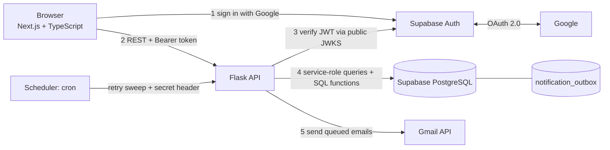
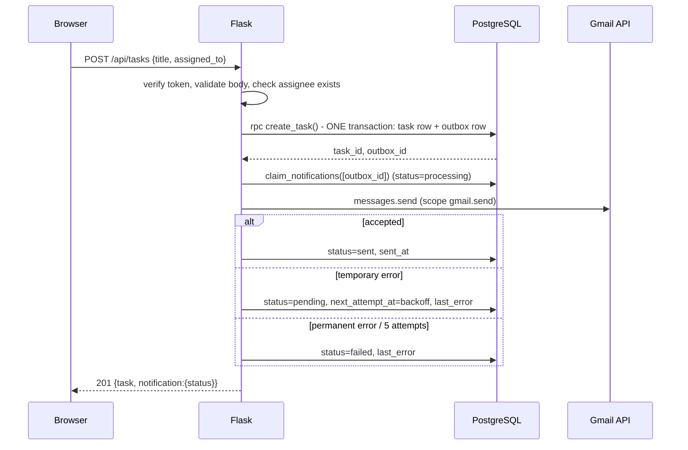

# TaskFlow - Task Management App

Create tasks, assign them to registered teammates, and get an email when work is assigned or completed.

> **Status:** built and tested locally. **Not deployed, not connected to a real Supabase/Google/Gmail account yet.**
> See [`docs/STATUS.md`](docs/STATUS.md) for exactly what has and has not been verified. Live URL: *none yet*. GitHub URL: *none yet*.

## Problem
Small teams lose track of who owns what. TaskFlow gives each task a creator and an assignee, shows each person their own work,
and emails the right person at the right moment - without ever letting someone read tasks that are not theirs.

## Features
* Google sign-in (Supabase Auth), logout, protected pages, expired-session handling
* Create / view / edit / delete tasks; statuses `pending`, `in_progress`, `completed`; reopen allowed
* Assign to any registered user (name + email picker); reassign; unassigned tasks allowed
* Dashboard: counts, filters (scope + status), pagination, loading / empty / error states
* Gmail notifications: assignee on assignment, creator on completion (never for self-assigned / self-completed)
* Transactional outbox with idempotency key, bounded retries and recorded delivery status

## Permission rules
| Actor | Allowed |
|---|---|
| Creator | view, edit, reassign, change status, delete |
| Assignee | view, change status (complete / reopen) |
| Anyone else | **404** (existence not revealed) |

## Stack
Next.js 16 (App Router) · React 19 · TypeScript · Tailwind 4 · React Hook Form + Zod · Flask 3 (Blueprints) · Pydantic · PyJWT ·
Supabase (PostgreSQL + Auth + Google provider) · Gmail API · Vitest · pytest · Gunicorn.
Planned hosting: Vercel (frontend), Render or Railway (API), Supabase (DB/Auth). *(Not deployed yet.)*

## Architecture


### Authentication flow
```mermaid
sequenceDiagram
  participant B as Browser
  participant S as Supabase Auth
  participant G as Google
  participant F as Flask
  B->>S: signInWithOAuth(google, redirectTo=/auth/callback)
  S->>G: redirect to consent screen
  G->>S: callback with code
  S->>B: redirect /auth/callback?code=...
  B->>S: exchange code for session (PKCE)
  B->>F: GET /api/me  (Authorization: Bearer access_token)
  F->>S: fetch public keys (JWKS, cached)
  F->>F: verify signature, iss, aud, exp; take user id from "sub"
  F-->>B: profile
```
### Task creation & notification flow

Completion works the same way through `set_task_status()`; a second "completed" request is a no-op, so it cannot send a second email.

## Database
`profiles` (mirror of auth users) 1—* `tasks` (`created_by`, `assigned_to`) 1—* `notification_outbox`. Details, constraints, indexes: [`docs/DATABASE.md`](docs/DATABASE.md).

## API
Full table: [`docs/API.md`](docs/API.md).

## Local setup
Prerequisites: Node 22+, Python 3.12+, a Supabase project, a Google Cloud project (see [`docs/DEPLOYMENT.md`](docs/DEPLOYMENT.md) sections 1-3).
```bash
# 1) database: apply supabase/migrations/*.sql to your Supabase project (CLI: supabase db push)
# 2) backend
cd backend && python -m venv .venv && . .venv/bin/activate
pip install -r requirements-dev.txt
cp .env.example .env            # fill in values; never commit .env
flask --app wsgi run --port 5000   # or: gunicorn wsgi:app -b 127.0.0.1:5000
# 3) frontend
cd ../frontend && cp .env.example .env.local   # fill in values
npm install && npm run dev                        # http://localhost:3000
```
Environment variables are explained inline in `backend/.env.example` and `frontend/.env.example`.
Only `NEXT_PUBLIC_*` values are visible to browsers. `SUPABASE_SERVICE_ROLE_KEY`, `GMAIL_*`, `CRON_SECRET` exist **only** on the backend.

## Tests
```bash
cd backend && pytest -q && ruff check .          # 71 tests
cd frontend && npm run typecheck && npm run lint && npm test && npm run build   # 44 tests
pip install -r scripts/requirements.txt && python scripts/test_migrations.py     # 23 SQL checks on a real embedded PostgreSQL
```

## Security notes
* Authentication = verified JWT (asymmetric keys, `iss`/`aud`/`exp` checked, HS256 refused). Authorization = `TaskService` rules on every call. User id comes from the token, never the request body.
* Service-role key bypasses RLS, so Flask re-checks permissions itself; RLS remains as a second wall for any non-service access.
* SQL functions are executable by the service role only. Outbox has RLS with no policies.
* CORS restricted to `CORS_ORIGINS`. Logs contain method, path, status, time and user id - never headers, tokens or bodies.
* Post-login redirects are restricted to same-site relative paths (open-redirect protection).

## Known limitations & troubleshooting
See [`docs/STATUS.md`](docs/STATUS.md) (limitations) and below.
| Symptom | Likely cause |
|---|---|
| Every API call returns 401 `invalid_token` | Supabase project still on legacy HS256 keys (JWKS empty), or wrong `SUPABASE_URL` |
| Browser CORS error | `CORS_ORIGINS` must equal the frontend origin exactly (scheme + host, no trailing slash) |
| Google "redirect_uri_mismatch" | Google client lacks `https://<ref>.supabase.co/auth/v1/callback` |
| Redirect back to login after Google | Frontend URL missing from Supabase *Redirect URLs* allow-list |
| Emails stay `pending` | Gmail env vars unset, or cron not calling the process endpoint |
| Emails `failed` after ~a week | Gmail refresh token expired (consent screen in Testing) |

## Screenshots
*None yet - capture them after your first real run and add them under `docs/screenshots/`.*

## Future improvements
Search in assignee picker · server-side counts via SQL view · real queue/worker · optimistic concurrency (`updated_at` check) · Playwright E2E tests · in-app notifications · team/workspace scoping.

Interview study guide: [`docs/INTERVIEW_PREPARATION.md`](docs/INTERVIEW_PREPARATION.md).
