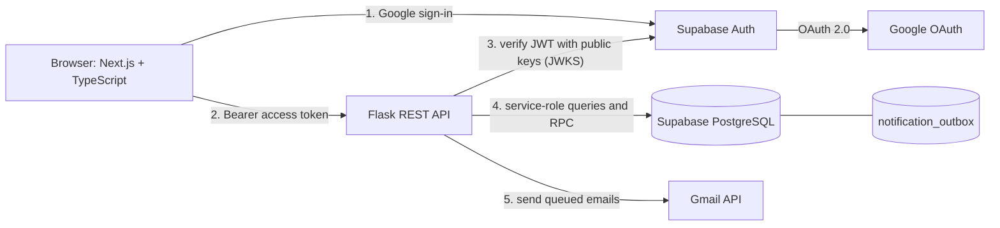

# Architecture

* The browser talks to **Supabase only for login**. All task data goes through Flask.
* Flask is the single place where authorization rules live.
* Task change + outbox row are written by one SQL function = one transaction.
* Hosting plan: Vercel (frontend), Render or Railway (Flask), Supabase (DB/Auth). *Not deployed yet - see docs/STATUS.md.*

## Key decisions
| Decision | Why |
|---|---|
| Flask verifies JWT using Supabase's public JWKS | No shared secret to leak; vetted library (PyJWT), no hand-written crypto |
| Service-role key only in Flask | It bypasses RLS; it must never reach a browser |
| RLS still enabled on every table | Defence in depth if a table is ever queried with a normal user key |
| Atomic SQL functions for writes that create emails | Task + outbox commit together or not at all |
| In-request send + cron retry sweep | Simple to explain; no separate worker host needed. Limits documented |
| Browser-held session (supabase-js) | Simple; trade-offs in INTERVIEW_PREPARATION.md |
